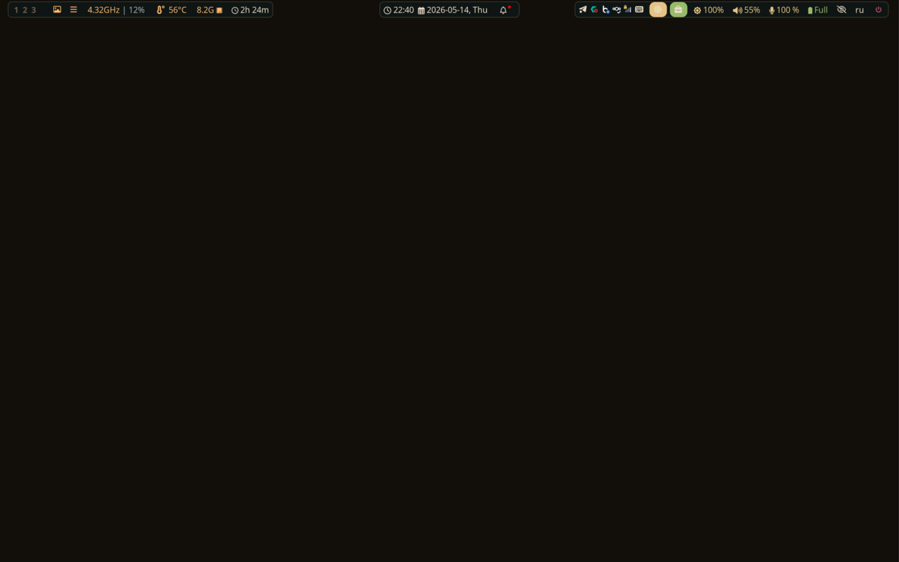
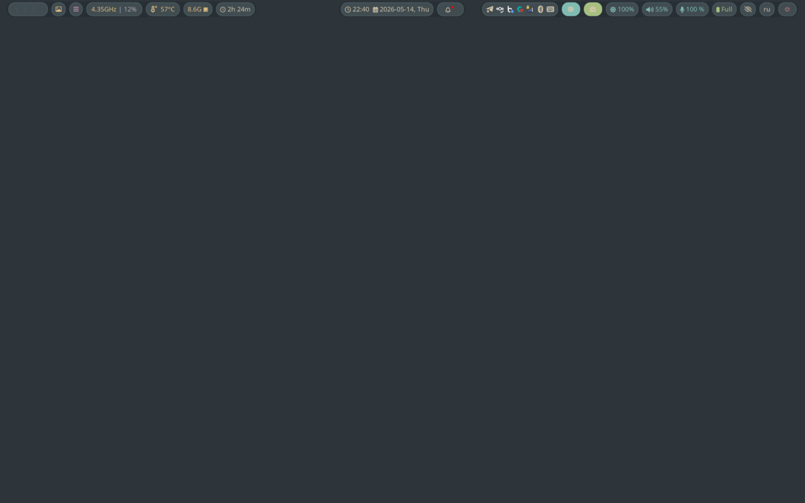
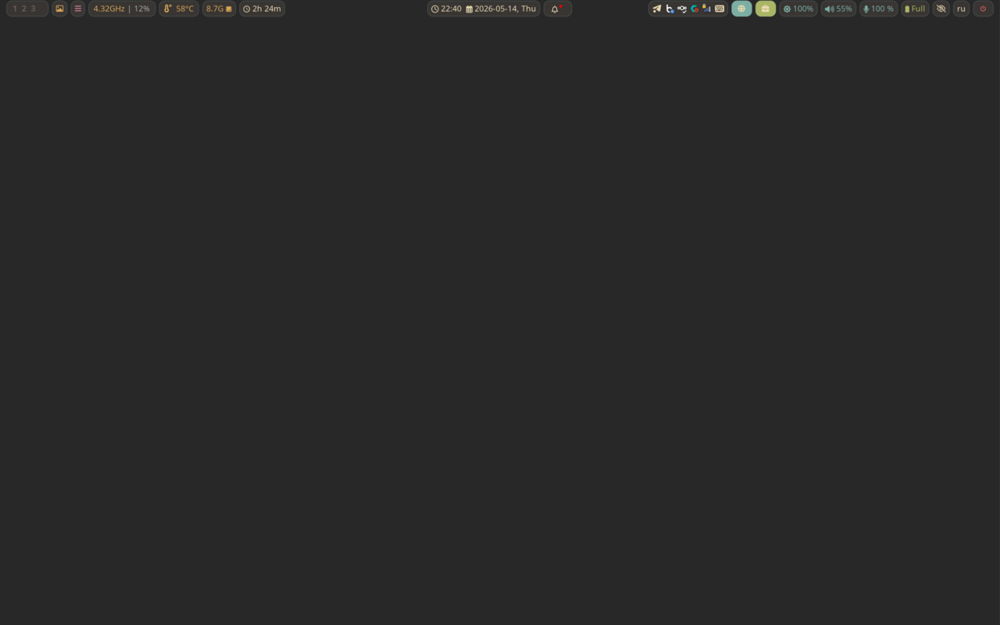
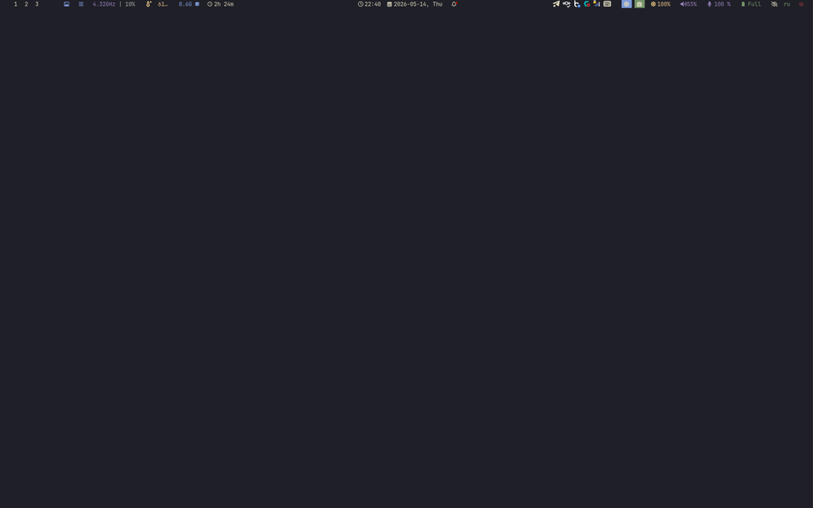
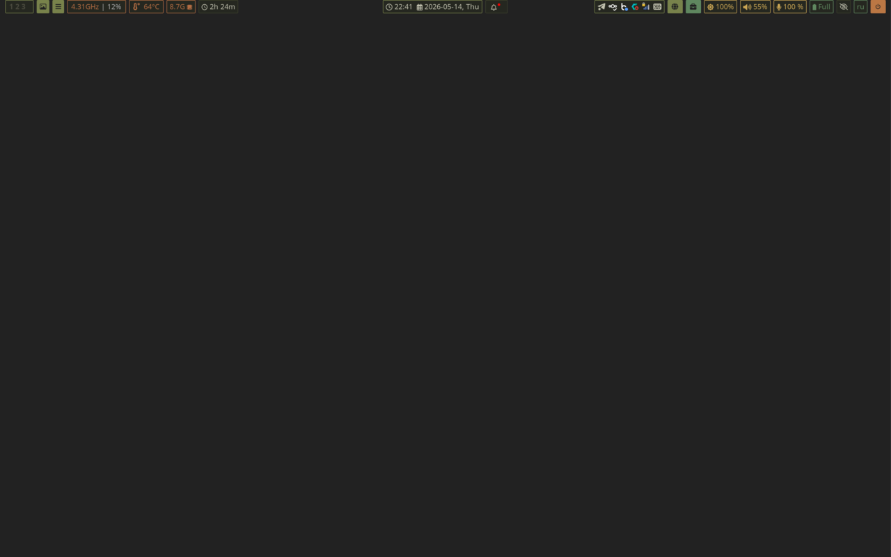
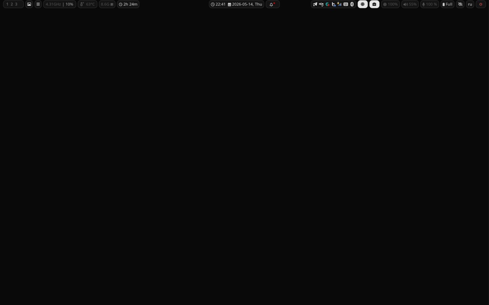
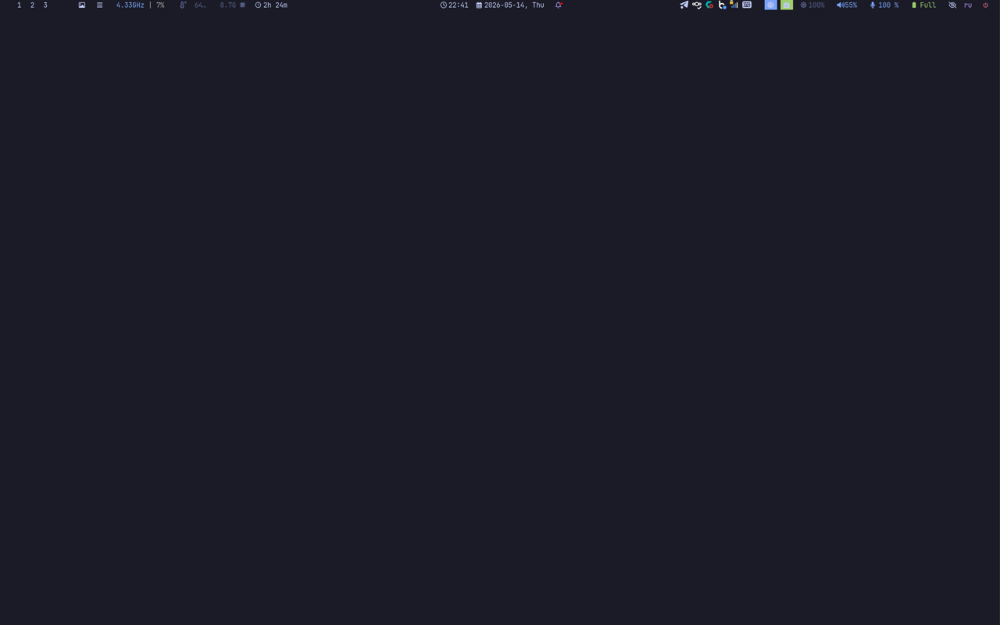
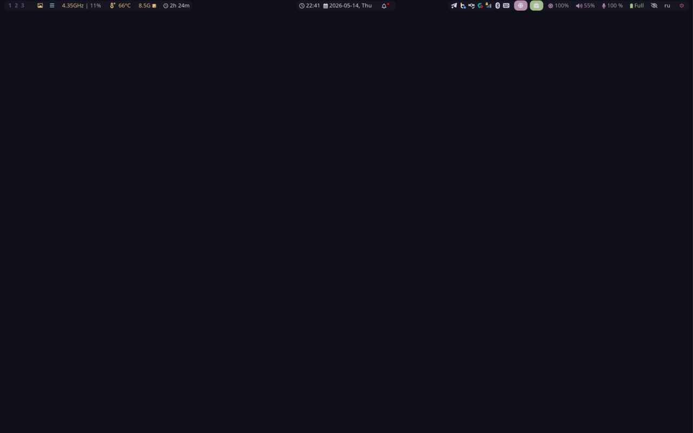

# Dotfiles

Personal Linux desktop configuration for Niri and Hyprland, with Waybar, Rofi, swaync, hyprlock, ly, systemd user services, and shared shell scripts. Both compositors live on `main`; select the session at login, not by switching Git branches. GNU Stow manages the files, with generated files kept out of Git.

Both sessions share one launcher stack, one theme switcher, one volume path, one wallpaper path, and the same session services.

## Desktop

- **Compositors:** Niri in `cfg/*.kdl`, or Hyprland 0.55+ in `hyprland.lua`.
- **Bar:** Waybar selects the compositor's workspace config automatically, with shared VPN, Wakatime, audio, brightness, battery, language, and notification modules. The `custom/kvn` button drives the [kvn](https://github.com/yarikov/kvn) VLESS client: left click runs `kvn toggle`, right click picks a profile in Rofi and connects to it.
- **Popups:** Niri uses Quickshell panels; Hyprland keeps native menu, pavucontrol, and wlogout actions.
- **Launcher:** Rofi for apps, clipboard, wallpapers, and theme selection.
- **Locking:** hyprlock with PAM fingerprint support and password fallback.
- **Idle:** swayidle, calling `hyprlock` and the current compositor's monitor power actions.
- **Display manager:** ly on `tty1`.
- **Wallpaper:** `awww` for images and `mpvpaper` for videos.
- **Themes:** one preset system applies Waybar, Rofi, GTK/libadwaita, Qt/KDE, swaync, hyprlock, and wlogout together.

## Layout

```
.config/niri/          Niri session, outputs, input, rules, keybinds, autostart
.config/waybar/        Bar config, active theme layers, Wakatime/status scripts
.config/quickshell/   Native Wayland panels for audio, network, power,
                      display, media, and calendar.
.config/themes/        Unified theme presets and generator
.config/rofi/          Launcher, clipboard, wallpaper, and theme menus
.config/swaync/        Notification center config, CSS template, focus helper
.config/desktop/       Shared scripts for menu, volume, brightness, wallpaper
.config/dotfiles/      Shared helper library and machine-local profile example
.config/hypr/          Hyprland Lua session, app autostart, shared hyprlock config
.config/ly/            TTY display manager config and deploy helper
.config/systemd/user/  Session services started by dotfiles-session.target
.config/xkb/           Custom Russian shortcut-friendly XKB layout
etc/pam.d/hyprlock     PAM config for fingerprint unlock with password fallback
etc/systemd/            Root units plus logind/sleep drop-ins for hardware/session integration
etc/udev/rules.d/       Udev rules for power-source automation
scripts/               Package lists, setup helpers, doctor, PAM, SSH, DDC/CI
notes/                 Hardware and operational notes
```

## Install

Install packages first:

```sh
~/.dotfiles/scripts/setup
```

The package sets live in `scripts/packages.pacman` and `scripts/packages.aur`.

Stow the files:

```sh
cd ~/.dotfiles
stow --restow --target="$HOME" .
```

Apply privileged pieces when needed:

```sh
sudo ~/.dotfiles/scripts/setup-pam
sudo ~/.dotfiles/scripts/setup-power
sudo ~/.dotfiles/scripts/setup-hibernate
sudo kvn setup --polkit
sudo ~/.dotfiles/scripts/setup-ddcci
~/.dotfiles/scripts/setup-ssh-agent
~/.dotfiles/scripts/setup-home-dns
~/.dotfiles/scripts/setup-stt
```

Deploy ly config explicitly:

```sh
sudo ~/.config/ly/apply.sh
```

`scripts/setup` also creates editable repo-local files from every `*.example`
template when the matching file without `.example` does not already exist, then
stows them into `$HOME`.

After setup, edit optional per-machine overrides as needed:

```sh
$EDITOR ~/.dotfiles/.config/dotfiles/machine.conf
```

Configure home split DNS after setting the local NetworkManager connection name
in `machine.conf` if it is not `eth`:

```sh
~/.dotfiles/scripts/setup-home-dns
```

This routes `*.home` to the local OPNsense DNS while VPN default DNS (`~.`)
continues to handle public names. It also adds a persistent `10.69.0.0/16`
route through the local gateway so home VLANs bypass full-tunnel VPNs.

Validate a machine after install:

```sh
~/.dotfiles/scripts/doctor
```

Run repository-level tests without touching the real home directory:

```sh
~/.dotfiles/scripts/test
```

## Machine-Local Files

These files are intentionally ignored and should stay outside Git:

```text
~/.gitconfig.local
~/.ssh/config.local
~/.ssh/yubikeys.tsv
~/.config/dotfiles/machine.conf
~/.config/Code/User/settings.json
~/.zshrc.local
```

On a machine that already has local Git or SSH config, move it into the local override files before stowing:

```sh
mv ~/.gitconfig ~/.gitconfig.local
mv ~/.ssh/config ~/.ssh/config.local
cd ~/.dotfiles
stow --restow --target="$HOME" .
```

## Niri

Niri is configured as small, readable files:

```text
.config/niri/config.kdl
.config/niri/cfg/input.kdl
.config/niri/cfg/display.kdl
.config/niri/cfg/layout.kdl
.config/niri/cfg/environment.kdl
.config/niri/cfg/autostart.kdl
.config/niri/cfg/rules.kdl
.config/niri/cfg/keybinds.kdl
```

Useful commands:

```sh
niri validate -c ~/.config/niri/config.kdl
niri msg outputs
niri msg windows
niri msg action load-config-file
```

The laptop panel is fixed at `3072x1920@120.000` with VRR disabled for stable frame pacing. External DP output can keep VRR in `display.kdl`.

## Hyprland

The settings from the former `hypr` branch live in `.config/hypr/hyprland.lua` on `main`, without reverting current Niri settings, shared services, themes, or Herdr integration. The disabled hyprexpo experiment is not included.

Select **Hyprland (uwsm-managed)** in ly so `graphical-session.target` owns the session lifecycle. The startup hook imports the Wayland environment, finalizes UWSM, and starts the same `dotfiles-session.target`, Gammastep, and swaync as Niri.

```sh
Hyprland --verify-config --config ~/.config/hypr/hyprland.lua
hyprctl configerrors
hyprctl monitors
```

Waybar selects `.config/waybar/config.hyprland` when `XDG_CURRENT_DESKTOP` contains `Hyprland`; Niri keeps its existing generated/theme config. Hyprland workspace buttons use the Lua dispatch API. Language OSD, notification-source focus, power-menu layout restoration, and idle DPMS actions select the current compositor too.

The former branch's complete history is retained under the `archive/hypr` tag; `main` is the only working branch.

## Themes

Themes are flat presets in `.config/themes/*.conf`. Applying a theme generates runtime files for the rest of the desktop. Each preset has `theme_mode=dark` or `theme_mode=light`; this drives GTK/libadwaita `color-scheme`, shell exports, and portal-aware apps such as browsers.

```sh
~/.config/themes/theme-switch list
~/.config/themes/theme-switch current
~/.config/themes/theme-switch apply tokyo-night
~/.config/themes/theme-switch menu
```

Theme previews are captured on an empty Niri workspace with each preset's `bg` color applied as a solid wallpaper.

GTK3 uses the configured `gtk_theme` plus generated `gtk.css`. GTK4/libadwaita apps read the generated `gtk-4.0/gtk.css` and `org.gnome.desktop.interface color-scheme`. GTK surfaces get a subtle automatic tint by blending each theme's `bg`, `muted`, and `accent`; presets can override this with `gtk_surface`, `gtk_sidebar`, and `gtk_header`. Already-running GTK apps may need to be restarted manually to reload generated CSS. Qt apps are themed globally through `QT_QPA_PLATFORMTHEME=qt6ct`, generated `qt5ct`/`qt6ct` palettes, and a small `dotfiles.qss` for menus and popups. Dolphin is the exception: it is launched through `~/.local/bin/dolphin` with the KDE platform theme so it uses KDE's native dark palette instead of Qt stylesheet file-view hacks.

`throne-bin` bundles its own Qt 6.11 without the `qt6ct` platform theme, so `~/.local/bin/throne` sets `LD_LIBRARY_PATH=/usr/lib` to make it load the system Qt (and the qt6ct plugin) instead. Restart Throne after Qt updates only if it fails to start; the bundled `ThroneCore` is unaffected.

Toolkit styling expects `adw-gtk-theme`, `qt5ct`, `qt6ct`, and `breeze` to be installed. `adw-gtk-theme` provides the GTK theme presets use, `qt5ct`/`qt6ct` load generated Qt palettes, and `breeze` provides KDE/Qt styling for Dolphin.

| Theme | Preview |
| --- | --- |
| `amber-forge` |  |
| `blood-moon` |  |
| `catppuccin-mocha` |  |
| `cyberpunk` |  |
| `dracula` |  |
| `everforest` |  |
| `gruvbox-dark` |  |
| `kanagawa-thin` |  |
| `kanagawa-wave` |  |
| `matte-black` |  |
| `miasma` |  |
| `mono` |  |
| `nord-frost` |  |
| `one-dark` |  |
| `rose-pine` |  |
| `tokyo-night` |  |
| `vantablack` |  |
| `violet-dusk` |  |

Generated files are ignored by Git:

```text
~/.cache/waybar/theme.css
~/.config/rofi/theme.rasi
~/.config/rofi/wallpaper-theme.rasi
~/.config/rofi/clipboard-theme.rasi
~/.config/gtk-3.0/gtk.css
~/.config/gtk-4.0/gtk.css
~/.config/swaync/style.css
~/.config/hypr/hyprlock-theme.conf
~/.config/wlogout/style.css
~/.config/wob/wob.ini
~/.config/swayosd/style.css
~/.config/alacritty/theme.toml
~/.config/kdeglobals
~/.local/share/color-schemes/Dotfiles.colors
~/.config/Code/User/dotfiles-theme.generated.json
~/.config/qt5ct/colors/dotfiles.conf
~/.config/qt6ct/colors/dotfiles.conf
~/.config/qt5ct/qt5ct.conf
~/.config/qt6ct/qt6ct.conf
~/.config/qt6ct/dotfiles.qss
~/.config/ly/theme.ini
~/.config/shell/theme.sh
```

The Waybar wallpaper button is the main theme entrypoint:

- Left click: wallpaper picker.
- Right click: theme picker.
- Middle click: random wallpaper.

## Keyboard

The XKB layout is `us,dotfiles` with the `,ru_ctrl_shortcuts` variant. Russian typing stays normal, but common `Ctrl` and `Ctrl+Shift` shortcuts resolve to the matching Latin physical keys.

Both compositors use the same layouts:

- `Alt+Shift` switches layout at XKB level.
- `Mod+Space` calls `lang_indicator next`, which dispatches through Niri or Hyprland; Waybar follows the compositor event.

The source files live in:

```text
.config/xkb/symbols/dotfiles
.config/xkb/rules/evdev.extras.xml
```

## Event-Driven Desktop Status

Waybar uses native `niri/language` / `hyprland/language` and `mpris` modules.
The custom Russian XKB registry description matches its compiled group name so
the native language modules can resolve it and show `ru`.

`desktop-layout.service` subscribes to Niri's JSON event stream or Hyprland's
layout IPC events. It writes the current layout to
`$XDG_RUNTIME_DIR/desktop-state/layout`, shows the layout OSD only on changes,
and sends `SIGUSR2` to Hyprlock. The lock-screen label reads this cache on startup
and on a signal (`cmd[update:0:true]`), not every 250 ms. `lang_indicator index`
and `lang_indicator next` remain available for keybinds and the power menu.
Caps Lock OSD retains a 0.5-second sysfs fallback inside the persistent process:
LED sysfs files do not reliably provide filesystem change notifications.

Other custom modules produce an initial JSON record and then emit only changes:

- `vpn_status vpn1 --watch` / `vpn_status vpn2 --watch`: NetworkManager D-Bus
  events, local machine settings and persisted slot-selection changes.
- `kvn_status --watch`: state-file changes, including atomic replacement and
  creation after startup; Linux pidfds detect tunnel exit even when stale state
  or a zombie PID remains.
- `gammastep_status --watch`: systemd unit state plus the native
  `gammastep/hooks/waybar-status` period-change hook. Its cached period is tied
  to the current Gammastep PID, so restarting the service cannot reuse stale
  day/night state. The hook also runs on Gammastep startup.

Continuous custom modules disable `exec-on-event`; mouse actions do not spawn
another subscription. `restart-interval` recovers an exited watcher, not a
periodic status poll. Directory monitors follow atomic file replacements.
CPU, temperature, brightness and the existing Hyprland workspace buttons
still use their configured measurement intervals.

After installing or updating these files:

```sh
systemctl --user daemon-reload
systemctl --user restart desktop-layout.service gammastep.service
~/.config/themes/theme-switch apply "$(~/.config/themes/theme-switch current)"
```

The compositor startup imports its IPC environment before starting shared
services. `scripts/test` checks both compositor configurations and runs
`scripts/test_desktop_events.py` for layout transitions, native XKB registry
compatibility and actual file/process lifecycle events.

## Audio And Brightness

Volume and microphone controls go through one script:

```sh
~/.config/desktop/scripts/volume --get
~/.config/desktop/scripts/volume --inc
~/.config/desktop/scripts/volume --dec
~/.config/desktop/scripts/volume --toggle
~/.config/desktop/scripts/volume --toggle-mic
```

Brightness uses backlight first and DDC/CI fallback for external monitors:

```sh
~/.config/desktop/scripts/brightness --json
~/.config/desktop/scripts/brightness --inc
~/.config/desktop/scripts/brightness --dec
~/.config/desktop/scripts/brightness --cycle
```

The backlight path requires the `ddcci` DKMS module built for the running kernel and bound to the monitor's current I2C bus. `scripts/setup-ddcci` reads `DOTFILES_DDCCI_BUS` from `~/.config/dotfiles/machine.conf`; use `ddcutil detect --brief` if bus numbering changes. Without `/sys/class/backlight/ddcci*`, brightness falls back to `ddcutil`, which can take several seconds per VCP query. After a kernel update, verify `dkms status` includes `uname -r`. The installed ddcci 0.4.5 source needs `<linux/string.h>` and `strncpy(..., PAGE_SIZE)` replaced with `strscpy(...)` in its five attribute readers to build against Linux 7.2.

Both scripts write to `/tmp/niri.wob` for the on-screen value display.

## Wallpaper

The wallpaper picker supports images and videos:

```text
jpg jpeg png webp gif mp4 webm mkv
```

Relevant scripts:

```text
.config/desktop/scripts/wallpaper_switcher
.config/desktop/scripts/change_wallpaper
```

Video thumbnails are generated with `ffmpeg`. Video wallpapers use `mpvpaper`; image wallpapers use `awww`.
`DOTFILES_WALLPAPER_DIR` and `DOTFILES_MPV_HWDEC` can be overridden in `~/.config/dotfiles/machine.conf`; hardware decoding is disabled by default for stability on mixed-GPU Wayland sessions.

## Lock And Idle

`hyprlock` is the screen locker for both Niri and Hyprland.

Session services are grouped under `dotfiles-session.target`:

```text
waybar.service
wob.service
swayosd.service
swayidle.service
clipboard-history.service
herdr.service
wallpaper.service
stt-server.service
```

Both compositors import the Wayland environment before starting this target, Gammastep,
and swaync. The dotfiles session services are tied to `graphical-session.target`
and stop when the graphical session ends; Herdr remains persistent by design.

The Herdr user service is started from this target only after the compositor imports the Wayland environment. Its drop-in skips the earlier `default.target` start, which otherwise leaves Herdr-spawned agents without `WAYLAND_DISPLAY` and breaks image paste.

The update tray applet belongs to XDG autostart, not the shared service start
command. The local `~/.config/autostart/arch-update-tray.desktop` override waits
for `org.kde.StatusNotifierWatcher` before launching `arch-update --tray`.

Idle flow:

- `swayidle` starts from the shared session target.
- 5.5 minutes: monitors turn off through Niri power actions or Hyprland Lua DPMS dispatch; input turns them back on.
- 30 minutes: launch `hyprlock` asynchronously so idle monitor-wake callbacks remain responsive.
- Before sleep: start `hyprlock` with `swayidle -w`. Waiting is retained to avoid starting sleep before the locker acquires the session lock; because hyprlock does not daemonize, this may use logind's default five-second delay-inhibitor window.

Fingerprint unlock is enabled in `~/.config/hypr/hyprlock.conf` through `auth.fingerprint`. `/etc/pam.d/hyprlock` intentionally stays password-only so hyprlock does not run a second `pam_fprintd` flow in parallel with its built-in fingerprint auth. ly intentionally does not use fingerprint PAM because TTY display managers can hang or behave poorly with fingerprint prompts.

## Power

Left-click Waybar's power icon for the full wlogout menu. In Niri, right-click it or use `Mod+Ctrl+P` for the compact Quickshell power panel.

- **Screen off** (wlogout key `d`): disable all displays through Niri monitor power actions or Hyprland Lua DPMS. The computer and applications keep running; this does not suspend or lock the session. Keyboard/mouse input wakes the displays; Hyprland enables both DPMS wake options explicitly.
- **Sleep** (wlogout key `u`): use `systemctl sleep`, respecting logind's supported `SleepOperation` policy instead of forcing `suspend`. With hibernation configured this is `suspend-then-hibernate`.
- **Hibernate**: shown in wlogout only when logind reports `CanHibernate=yes` or `challenge`. Zram alone is not a hibernation target.
- **Lock**: launch hyprlock directly; this does not depend on an unconfigured logind `Lock` listener.
- **Logout**: dispatch to the current compositor. Shutdown and reboot retain their standard systemctl commands.

Session actions close the menu before starting. Screen-off and sleep requests wait one second for the activating input and wlogout's layout restoration to settle, avoiding an immediate wake. The Quickshell session buttons use detached processes and do not leave an exclusive-focus overlay open during sleep.

Power source changes are handled by `/etc/udev/rules.d/90-dotfiles-power-profile.rules`, which starts `dotfiles-power-profile.service`.

The service runs `/usr/local/libexec/dotfiles-power-profile`:

- On battery: `powerprofilesctl set power-saver`, PCIe ASPM `powersave`, Wi-Fi power saving on.
- On AC: `powerprofilesctl set balanced`, PCIe ASPM `default`, Wi-Fi power saving stays on.

Install the privileged pieces with:

```sh
sudo ~/.dotfiles/scripts/setup-power
```

Check the active state:

```sh
powerprofilesctl get
cat /sys/module/pcie_aspm/parameters/policy
iw dev wlan0 get power_save
```

### Hibernation

`sudo ~/.dotfiles/scripts/setup-hibernate` prepares suspend-then-hibernate on btrfs:

- Creates the top-level subvolume `@swap`, mounted at `/swap`, so snapper snapshots of `/` never contain the swapfile and snapshots stay possible while swap is active.
- Creates `/swap/swapfile` sized to RAM with `btrfs filesystem mkswapfile` and enables it with priority 10, below zram (100). Normal paging stays in zram; systemd skips zram when choosing the hibernation device.
- Backs up `/etc/fstab` before adding the `/swap` mount and swap entries. Rerunning is idempotent.
- Installs `etc/systemd/sleep.conf.d/10-dotfiles-hibernate.conf`: hibernate after 2 hours of suspend on battery, or earlier below 5% battery. On AC the system stays suspended; the countdown starts after unplugging.
- Installs `etc/systemd/logind.conf.d/10-dotfiles-sleep.conf`: lid close and the sleep key use `sleep`, the same policy as the power menu. Without hibernation swap it falls back to plain suspend. It reloads logind, never restarts it.

Resume needs no `resume=` kernel argument or Limine change: systemd stores the swapfile location in the `HibernateLocation` EFI variable and the `systemd` initramfs hook resumes from it.

The swapfile lives inside the LUKS-encrypted root (see Disk Encryption), so the hibernation image is encrypted at rest; resume runs after the initramfs unlocks `root`.

Test after setup, then check the resume in the next boot's journal:

```sh
systemctl hibernate
journalctl -b -u systemd-hibernate-resume.service
```

### Disk Encryption

On laptopchik the btrfs root partition is LUKS2 (`aes-xts-plain64`, 512-bit key). It was converted in place with `cryptsetup reencrypt --encrypt --reduce-device-size 32m`, so the btrfs UUID and Limine `root=UUID=...` stayed unchanged; only the ESP (`/boot`) is unencrypted. The setup is system state, not stowed files:

- `/etc/mkinitcpio.conf`: `sd-encrypt` sits between `plymouth` and `filesystems`, so plymouth draws the PIN prompt.
- `/etc/crypttab`: `root UUID=<luks-uuid> none fido2-device=auto,discard,x-initrd.attach`. mkinitcpio copies `x-initrd.attach` entries into the initramfs; `/etc/crypttab.initramfs` is deprecated.
- Rebuild with `sudo limine-mkinitcpio`, not plain `mkinitcpio -P`: `limine.conf` pins initramfs hashes.
- Keyslots: one `systemd-fido2` token per YubiKey (PIN + touch) and a `systemd-recovery` key stored in Bitwarden. No passphrase slot.

Enroll a new or replacement YubiKey (only that key plugged in) or rotate the recovery key, authenticating with an enrolled YubiKey:

```sh
sudo systemd-cryptenroll --unlock-fido2-device=auto --fido2-device=auto /dev/nvme0n1p2
sudo systemd-cryptenroll --unlock-fido2-device=auto --wipe-slot=recovery --recovery-key /dev/nvme0n1p2
```

Snapper snapshots taken before the conversion boot an initramfs without `sd-encrypt` and cannot unlock the root.

## Notes

- `DEPENDENCIES.md` lists the package set and post-install commands.
- `notes/yubikey_pool.md` documents the dynamic YubiKey/SSH signing pool.
- `notes/thinkpad_setup_process.md` keeps hardware and migration notes.
- Niri and Hyprland are maintained together on `main`. Wofi, Swaylock, legacy Waybar styles, and unused Waybar modules remain removed.
- Machine-specific knobs live in `~/.config/dotfiles/machine.conf`; keep host quirks there instead of hardcoding them into shared scripts.
